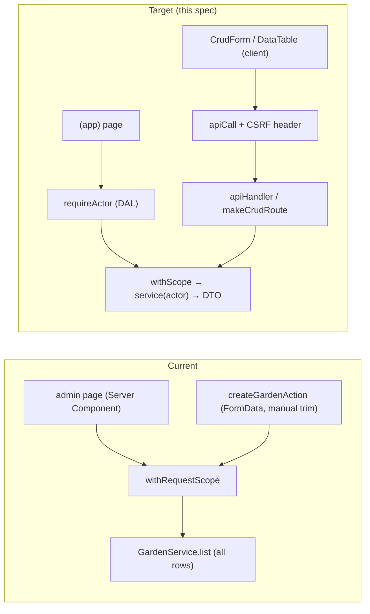

# App primitives: the backend and frontend layer every concept builds on

- **Status:** draft (design approved at the gate on 2026-10-20).
  - **Implementation gate:** the owner's Q3 answer let the primitives proceed while the grid waits for A04. The brief, however, says implementation planning waits for D05, A04 and Q07, and no decision supersedes D05. ⚠️ The owner must confirm before Phase 1 that D05 doesn't block this layer, and record that confirmation in the brief.
- **Date:** 2026-10-20
- **Origin:** issue #13. The owner asked that the spec for the grid feature also define the reusable layer under it. The grid itself is in [`2026-10-20-garden-grid.md`](2026-10-20-garden-grid.md) (spec B), which is this spec's first consumer.
- **Design authority:** `AGENTS.md` (Reusable API & UI layer, Security minimums, Persistence & DI), `.ai/docs/engineering-standards.md` §1, §4, §5 steps 1–3, `.ai/specs/product-brief.md` (D07–D09, R06)

## 📝 TLDR

Today every write goes through hand-written code: one Server Action trims `FormData` by hand, there is no error type, no envelope, no Zod, no logger, no users and no ownership, so the one `Garden` table is readable by anyone. **Proposed (future behavior):** add the small, explicit layer `AGENTS.md` already mandates and make it concrete:

- **Server:** typed errors, one rule-result contract for pure rules, `apiHandler`, `makeCrudRoute`, minimal email + password auth, ownership resolved through the owner root, and a locked aggregate write.
- **Client:** `apiCall`, `useMutation`, `CrudForm`, `DataTable`, the feedback states and an app shell.

The layer is proven end to end by one consumer, **owned gardens**. A signed-in user creates, renames and deletes their gardens, and can't see anyone else's.

## Resolved gate (owner, 2026-10-20)

| # | Question | Answer |
|---|---|---|
| Q1 | One spec or two? | Two: this spec (primitives) and spec B (grid) as its first consumer. |
| Q2 | Auth? | Minimal email/password auth is part of this spec. |
| Q3 | Readiness (D05, A04, Q07 open)? | Write the full design now. Spec B's grid phases are blocked on A04. No phase here depends on how plants fit a grid, but D05 still needs the owner's explicit lift (see Status). |
| Q4 | Tree outside any bed? | A planting may exist without a bed (D10, R07). This affects spec B only. |

## 📝 Problem Statement

The brief's Now list (D07) has three features: a calendar with a task list, beds with companion warnings, and AI answers. Each one needs the same plumbing. Without a shared layer, each will grow its own version of it. The table below lists what the features need, taken from `AGENTS.md`, the brief and the standards. It's the requirement set for this spec.

| Need | Calendar + tasks (D07 #1) | Beds + plantings (D07 #2) | AI answers (D07 #3, D08) | Catalogue (D04) |
|---|---|---|---|---|
| Signed-in user, data scoped to them | frost dates per user | gardens, beds, plantings | conversation, quota | — (public read) |
| Ownership resolved through an owner root (fail closed, no existence leak) | via garden | bed → garden, planting → garden | via garden | — |
| Bounded Zod input shared by form and route | frost-date settings, overrides | bed size, placement | question length | list filters |
| Typed domain errors → stable codes → envelope | invalid override | `CELL_OCCUPIED`, `OUT_OF_BOUNDS`, `STALE_VERSION` | `AI_UNAVAILABLE`, `RATE_LIMITED` | `NOT_FOUND` |
| Pure rules returning structured violations | sowing windows | grid rules, companion conflicts | AI output against catalogue | seed integrity |
| Computed-on-read views (never stored) | windows, tasks | conflicts | — | — |
| Concurrent-write safety on an aggregate | — | bed `version` + lock | — | — |
| Plain CRUD over an owned resource | — | gardens, beds | — | read-only list |
| Rate limiting | — | — | per-user quota + per-minute | — |
| Date-only values (`YYYY-MM-DD`) | frost dates, windows | — | — | timing offsets |
| Client: call the API, show field errors, loading/empty/error, lists | settings form, task list | bed form, plant list, grid | question form, answer | catalogue table |
| Redacted logs, typed env | ✓ | ✓ | AI metadata only | ✓ |

Not needed by Now, so not built: multipart upload (`upload.ts`, `apiUpload`) and the image dropzone, because photos are Later (D09). The domain event emitter isn't built either, because no Now side effect needs it (`AGENTS.md`: "emit only when a side effect needs the event"). Both keep their reserved names and are designed when their first consumer arrives.

## 📝 Proposed Solution

Build the layer bottom-up in thin, separately shippable phases. Each primitive ships with its tests, and with its first real consumer wherever one exists.

**Designed here, built with its first consumer** (no dead code before then; contracts are fixed in this spec):

| Primitive | Built in |
|---|---|
| `RuleResult` | spec B Phase 3 (grid rules) |
| `withAggregateLock` | spec B Phase 2 |
| `useMutation` `onConflict` + `sonner` notice | spec B Phase 2 |
| `CellGrid` | spec B Phase 3 |
| `dateOnlySchema` | calendar spec (frost dates) |
| `listQuerySchema` (cursor) | the first list that outgrows its limit |
| `apiCallOrThrow` | its first caller |

**The guiding contract** is one request lifecycle, the same for every concept:

```
Route Handler ── apiHandler(options, fn)
   1. CSRF header check (state-changing methods)
   2. session  ── requireSession → Actor { userId }          (or public)
   3. rate limit ── optional key (login, register, AI)
   4. parse    ── params / query / body with bounded Zod      → ValidationError(fieldErrors)
   5. withScope ── Awilix request scope, forked em
   6. fn(ctx)  ── service call(s); services enforce ownership with the Actor
   7. envelope ── { ok: true, data } | { ok: false, error: { code, message, fieldErrors?, details? } }
Server Component ── getActor() (DAL, React cache) → withScope → service → DTO → props
Client Component ── apiCall / useMutation → envelope → field errors | refresh | conflict reload
```

**Alternatives considered:**

- **Server Actions for client writes** (the current admin pattern). Rejected: `AGENTS.md` makes `apiCall` → `/api/*` the only sanctioned client write path. Actions would need a second error and envelope mapping, and they're harder to drive from integration tests and from the future AI apply path.
- **A typed RPC layer (tRPC-style) with generated client types.** Rejected: `ui` must not import `core`, so the envelope stays a shape convention. A codegen step adds tooling the 25-hour budget (D06) can't carry.
- **Ownership checks in routes, after loading the record.** Rejected: services are reused by pages and by the future AI path. A check placed in the route is skipped by the second caller. Ownership is part of the query instead (see Architecture), which also returns 404 rather than 403, so record ids can't be probed.
- **Session table instead of a stateless JWT.** Rejected for MVP: `AGENTS.md` fixes a JWT with 24 h expiry and no refresh. The limitation (logout can't revoke a stolen token before expiry) is documented in Risks.

## 📝 Architecture

### Prerequisite: layout alignment (standards §5 steps 1–2)

Every file path below assumes the target layout: `@plantai/*` scope, `packages/db` owning entities, migrations and ORM config, `core/src/container/{container,cradle}.ts`, `core/src/services/<concept>/`, and `withScope`. Branch `refactor/scope-plantai` exists locally, and step 1 may already be in progress there. Phase 0 finishes these steps mechanically, as the standards describe, with no design changes.

Phase 0 also carries the **rules alignment** the brief owes: D02 (bushes and trees), D08 (the AI feature is Q&A; the layout proposal is Later), D09 (journal, photos and spraying are Later) and R07 (D10) change `AGENTS.md` and the standards. Doing this first means later phases follow the updated rules, for example not building `upload.ts`.

### Server primitives (`packages/core`, `packages/db`)

| Primitive | File | Contract (summary) |
|---|---|---|
| Typed env | `core/src/config/env.ts` | Zod schema parsed lazily on first access, so the build doesn't need env. Adds `JWT_SECRET` (≥ 32 bytes, required at request time only), `LOG_LEVEL`. Every var is documented in `.env.example`. |
| Logger | `core/src/logger.ts` | `pino` with `redact` paths for `password`, `passwordHash`, `token`, `authorization`, `cookie`, `*.apiKey`, `jwt`. Each request gets a child logger with `requestId` (from `x-request-id` or `crypto.randomUUID()`). |
| Errors | `core/src/http/errors.ts` | `AppError(code, message, { status, fieldErrors?, details? })`. Subclasses: `NotFoundError` 404, `UnauthorizedError` 401, `ForbiddenError` 403, `ValidationError` 422, `ConflictError` 409, `RateLimitedError` 429, `AiUnavailableError` 503, `PayloadTooLargeError` 413. Codes used in this spec: `VALIDATION_FAILED` (422), `NOT_FOUND` (404), `UNAUTHORIZED` (401), `CSRF_REJECTED` (403), `REGISTRATION_FAILED` (422), `INVALID_CREDENTIALS` (401), `LIMIT_REACHED` (409), `RATE_LIMITED` (429), `PAYLOAD_TOO_LARGE` (413), `INTERNAL` (500). Each feature spec adds its own codes to this list, e.g. spec B's `UNKNOWN_CROP` (422). `code` is a stable `SCREAMING_SNAKE` string, and the client switches on it, never on `message`. `details` is an explicit, JSON-safe object a subclass chooses to expose (for example conflicting cells). It's never the cause or the stack. |
| Rule result (built in spec B) | `core/src/rules/rule-result.ts` | `type Violation = { code: string; message: string; path?: (string\|number)[]; meta?: Record<string, JsonValue> }` and `type RuleResult = { ok: true } \| { ok: false; violations: Violation[] }`. Helpers: `pass()`, `fail(...v)`, `combine(...results)`, `throwIfViolations(result, toError)`. Every pure rule module (grid rules, companions, sowing windows, AI-output checks) returns this. The same violation list feeds HTTP `details`, AI-retry decisions and UI highlights. |
| Common validators | `core/src/validators/common/` | Built now: `uuidSchema`, `idParamsSchema`, `boundedText(max)`. Built with first consumer: `versionSchema` (int ≥ 1, spec B), `dateOnlySchema` (strict `YYYY-MM-DD`, a real calendar date, kept as a string; calendar spec), `listQuerySchema` (`limit` ≤ `MAX_PAGE_SIZE`, opaque `cursor`). All limits are named constants in `core/src/validators/limits.ts`. |
| Client-safe validators entry | `@plantai/core/validators` (package `exports` subpath) | Exports only `validators/**`. An ESLint `no-restricted-imports` rule bans imports from `services`, `container`, `http`, `@plantai/db` or `server-only` inside `validators/**`, so Client Components can import schemas without pulling in server code. This is the one sanctioned client import of `core`. `ui` still never imports `core`: `app` passes schemas into `ui` components as props. |
| DTO convention | per concept, `core/src/services/<concept>/<name>.dto.ts` | Services return plain DTOs (`toGardenDto(entity)`), never entities. Timestamps are ISO strings and date-only values stay strings. This prevents leaking columns such as `passwordHash` or `ownerId` and Next serialization surprises. |
| Request scope | `core/src/container/scope.ts` → `withScope(fn)` | Replaces `app/src/server/request-scope.ts`: one Awilix scope with a forked `em`, disposed in `finally`. Used by `apiHandler` and by Server Components. |
| Actor | `core/src/http/auth.ts` | `type Actor = { userId: string }`. A service method that touches owned data takes `actor` as its **first argument**. There is no ambient "current user", so a missing actor fails at compile time. |
| Session | `core/src/http/auth.ts` | `issueSessionCookie(userId)` / `clearSessionCookie()` return `Set-Cookie` values: `httpOnly`, `secure` in production, `sameSite=lax`, `path=/`, `Max-Age` = `SESSION_TTL_SECONDS` (24 h). `verifySessionToken(token) → Actor \| null` checks HS256, `exp` and `iss`. `requireSession(req) → Actor`, or throws `UnauthorizedError`. JWTs use `jose`: standard, zero-dependency and audited. A hand-rolled JWT is exactly what "20 lines of local code" must not cover. |
| Passwords | `core/src/services/auth/password.ts` | `bcryptjs`, cost `BCRYPT_COST = 12`. `verifyPassword` runs a dummy compare when the user doesn't exist, so timing doesn't reveal whether an email is registered. |
| Rate limiter | `core/src/http/rate-limit.ts` | Port `RateLimiter.consume(key, { limit, windowMs }) → { allowed, retryAfterSec }`. MVP adapter `InMemoryRateLimiter` (fixed window). It's registered with `asValue` in the **root** container, which is module-level and built once per Next layer (see `container.ts`), so its counters persist across requests. Only Route Handlers use it. The key is the normalised email (login, register) or the `actor.userId` (AI). A client IP joins the key only when `TRUSTED_PROXY_IP_HEADER` names a header the deploy's proxy overwrites, because raw `x-forwarded-for` is spoofable. Its first consumers are login and register (`LOGIN_ATTEMPTS_PER_WINDOW`), and the AI endpoint reuses it. |
| CSRF | inside `apiHandler` | For non-`GET`/`HEAD` requests, the request must carry `CSRF_HEADER` (`x-plantai-request: 1`). `apiCall` always sets it. Without it the request is rejected with `ForbiddenError` (`CSRF_REJECTED`). |
| `apiHandler` | `core/src/http/apiHandler.ts` | `apiHandler({ auth: "required" \| "public", params?, query?, body?, rateLimit?, successStatus? }, async (ctx) => data)` → `(req, routeCtx) => Response`. `ctx = { req, actor, params, query, body, cradle, log }`. It `await`s `routeCtx.params` (a Promise in Next 16). Zod failures become `ValidationError` with `fieldErrors` keyed by dotted path. A known `AppError` maps to its own status and code. Any other error is logged with `requestId` and returns `500 { code: "INTERNAL" }`. The body is size-checked against `MAX_JSON_BODY_BYTES` before `JSON.parse`. `core` builds web-standard `Response` objects and never imports `next`. |
| `makeCrudRoute` | `core/src/http/makeCrudRoute.ts` | `makeCrudRoute({ service: "<cradleKey>", createSchema, updateSchema, parent?: "<paramName>" })` → `{ collection: { GET, POST }, item: { GET, PATCH, DELETE } }`, built on `apiHandler` with `auth: "required"`. The service implements `CrudService<Dto, Create, Update>`: `list(actor, { parentId?, ...listQuery })`, `get(actor, id)`, `create(actor, input, parentId?)`, `update(actor, id, input)`, `remove(actor, id)`. `POST` returns 201. `DELETE` returns `{ ok: true, data: { id } }`. Workflow endpoints don't use it. |
| Owned lookup | `db/src/ownership.ts` (filters + `findOwned`) + `core/src/services/shared/owned.ts` (`findOwnedOrFail`) | `db` exports one owner filter per owned entity, e.g. `ownedBy.garden(userId) → { owner: userId }`, `ownedBy.bed(userId) → { garden: { owner: userId } }`, and `findOwned(em, Entity, id, filter) → entity \| null`. `core` wraps it as `findOwnedOrFail`, which throws `NotFoundError` when the row is missing **or** owned by someone else. A single filter per entity means "resolved through the garden" is written exactly once. `db` also re-exports the `EntityManager` type that services use, so only `db` imports `@mikro-orm/*` (`AGENTS.md`); `db` can't import `core` errors, so it returns `null` or a result and `core` maps that to an error. |
| Aggregate write | `db/src/aggregate-lock.ts` (lock + version, returns `{ status: "not_found" \| "stale" \| "ok" }`) + `core/src/services/shared/aggregate-write.ts` (maps to errors). **Designed here, built in spec B**, its first consumer. | `withAggregateLock(em, Entity, id, ownerFilter, expectedVersion, fn)`: opens `em.transactional`, checks ownership with `findOwned` (404 otherwise), then locks the root **by id alone** with `LockMode.PESSIMISTIC_WRITE`, so the lock query has no join and only the root row is locked, not the owner `gardens` row. It then compares `version` (mismatch → `ConflictError("STALE_VERSION", details: { currentVersion })`), runs `fn(root, txEm)`, bumps `version` and flushes. When several roots are locked, they are taken in ascending id order to avoid deadlocks. The row lock serializes concurrent overlap checks, and the version check rejects stale clients. Together they make "check bounds + overlap + version in one transaction" a single call. |

### Client primitives (`packages/ui/src/backend`, `packages/app`)

| Primitive | File | Contract (summary) |
|---|---|---|
| `apiCall` / `apiCallOrThrow` | `ui/src/backend/api/apiCall.ts` | `apiCall<T>(path, { method, body, signal })` → `ApiResult<T> = { ok: true, data: T } \| { ok: false, status, error: { code, message, fieldErrors?, details? } }`. It always sends JSON, `CSRF_HEADER` and `credentials: "same-origin"`. Envelope parsing is defensive: a non-JSON body or a network failure becomes `{ code: "NETWORK" }` or `{ code: "BAD_RESPONSE" }`, and it never throws (`apiCallOrThrow` throws `ApiError`). It is the only `fetch("/api…")`, enforced by an ESLint `no-restricted-syntax` rule. |
| `useMutation` | `ui/src/backend/api/useMutation.ts` | `useMutation(fn, { onSuccess?, onConflict? })` → `{ run, isPending, error, fieldErrors, reset }`. On `STALE_VERSION` it calls `onConflict` (the app passes `router.refresh()` plus a notice). `ui` stays free of `next/*`. There is no client cache library: reads are server-rendered, and writes either refresh or return the updated aggregate. |
| Feedback | `ui/src/backend/feedback/{LoadingMessage,ErrorMessage,EmptyState}.tsx` | The only loading, error and empty renderers. `ErrorMessage` takes an `ApiResult` error and shows `message`, never `details`. |
| `CrudForm` | `ui/src/backend/forms/CrudForm.tsx` | Props: `schema` (Zod), `fields: FieldConfig[]` (`text`, `textarea`, `number`, `select`, `date`), `defaultValues`, `onSubmit(values) → Promise<ApiResult>`, `onCancel?`, `submitLabel`. It validates on submit with the same schema, merges server `fieldErrors`, and supports `Cmd/Ctrl+Enter` (submit) and `Escape` (cancel). Labels are associated with fields, the first invalid field gets focus, and the submit button is disabled while pending. `zod` becomes a peer dependency of `ui`. |
| `DataTable` | `ui/src/backend/tables/DataTable.tsx` | `columns: { key, header, cell(row), hideOnMobile? }[]`, `rows`, `getRowId`, `rowActions?`, plus `loading`, `empty` and `error` slots that delegate to `feedback/`. Below the `md` breakpoint it switches to card mode. There is no built-in pagination in MVP: lists are bounded by the limits constants, and the `listQuerySchema` cursor is ready when a list outgrows them. |
| `ConfirmDialog` | `ui/src/backend/dialogs/ConfirmDialog.tsx` | Wraps the shadcn `alert-dialog` (added via `npm run ui:add`) and is used for every destructive action. |
| `AppShell` | `ui/src/backend/layout/AppShell.tsx` + `PageHeader.tsx` | A mobile-first shell (bottom nav on small screens, sidebar on `md+`). Its nav items come from props. |
| `CellGrid` | `ui/src/backend/grid/CellGrid.tsx` (**designed here, built in spec B**) | A concept-agnostic `rows × cols` grid of items `{ id, row, col, rowSpan, colSpan, label, tone }`. It handles cell and rectangle selection (tap start, then tap end; Shift+arrows on keyboard), `role="grid"` with arrow-key navigation and an `aria-label` per cell, and a highlight overlay for cells named in `error.details`. It doesn't validate placement: validity comes from the server (`AGENTS.md`). |
| Session DAL (app) | `app/src/server/session.ts` | `getActor = cache(async () => verifySessionToken((await cookies()).get(SESSION_COOKIE)?.value))`, plus `requireActor()`, which redirects to `/login`. Per the Next 16 auth guide this check sits next to the data, in every `(app)` page, not only in the layout, because a layout doesn't re-run on client navigation. `proxy.ts` isn't added (YAGNI: the guide marks it optional, optimistic and not a defence). |

### Request flow, current → target



Takeaway: the request is checked at the edges (`apiHandler`, the DAL), and ownership is enforced in the service through the owner filter. A page and an API route reach the same guarded service method.

## 📝 Data Model

| Entity | Table | Fields (beyond `id`, `createdAt`, `updatedAt`) | Notes |
|---|---|---|---|
| `User` (new) | `users` | `email` `varchar(254)` unique (stored lower-cased and trimmed), `passwordHash` `varchar(100)` | No name, no location (location comes with the calendar spec as frost dates + coarse region only). The DTO never contains `passwordHash`. |
| `Garden` (changed) | `gardens` | adds `owner` → `users.id`, **not null**, `on delete cascade` | `GardenDto = { id, name, description, createdAt }` |

Migrations: `add-users` (Phase 4) creates `users`; `add-garden-owner` (Phase 5) **deletes existing `gardens` rows** (bootstrap demo data with no possible owner) before adding `owner_id not null`. Commit the SQL and snapshot for each.


## 📝 API Contracts

All responses use the envelope. Codes listed are the stable error codes.

| Route | Auth | Request | Success | Errors |
|---|---|---|---|---|
| `POST /api/auth/register` | public, rate-limited | `{ email (≤254, email), password (MIN_PASSWORD_LENGTH 10 – MAX_PASSWORD_LENGTH 128) }` | 201 `{ user: { id, email } }` + session cookie | `VALIDATION_FAILED`, `REGISTRATION_FAILED` (generic, also returned for an existing email), `RATE_LIMITED` |
| `POST /api/auth/login` | public, rate-limited per IP + email | same shape | 200 `{ user }` + cookie | `INVALID_CREDENTIALS` (generic), `RATE_LIMITED` |
| `POST /api/auth/logout` | required | — | 200, cookie cleared | `UNAUTHORIZED` |
| `GET /api/auth/me` | required | — | 200 `{ user }` | `UNAUTHORIZED` |
| `GET, POST /api/gardens` | required | `gardenCreateSchema { name: boundedText(MAX_GARDEN_NAME 120), description?: boundedText(MAX_DESCRIPTION 2000) \| null }` | list `GardenDto[]` (owner's only, newest first); 201 `GardenDto` | `VALIDATION_FAILED`, `LIMIT_REACHED` (> `MAX_GARDENS_PER_USER` 20, counted while the user row is locked `FOR UPDATE`, so concurrent creates can't overshoot) |
| `GET, PATCH, DELETE /api/gardens/[id]` | required, owned | `gardenUpdateSchema` = partial of create | `GardenDto` / `{ id }` | `NOT_FOUND` (missing **or** not owned) |

`/api/health` is untouched. It keeps its own non-envelope shape (`BACKWARD_COMPATIBILITY.md`).

Registration with an existing email returns the same generic error as any other failure. This is a deliberate UX cost of not revealing which emails exist (`AGENTS.md`). The user sees "Could not create the account. If you already have one, log in."

## 📝 UI/UX

- **Route groups:** `(auth)/login`, `(auth)/register` and `(app)/gardens`, each with its own root layout that loads the `@plantai/ui` theme. `(frontend)` and `/admin` stay as they are; renaming `(frontend)` to `(marketing)` isn't part of this diff.
- **`/login` and `/register`:** a `CrudForm` with email and password. On success, `router.push("/gardens")`. Errors appear inline, and the password field is never echoed back.
- **`/gardens`:** `PageHeader` with a "New garden" button that opens a `CrudForm` in a sheet, then a `DataTable` (name, description, created) whose row actions are rename and delete (with `ConfirmDialog`). The empty state is "No gardens yet — create your first one". States covered: loading (pending mutation), empty, error and validation.
- **Admin:** `/admin/gardens` and `createGardenAction` are **removed**. An unauthenticated listing of every user's gardens would break ownership. The `/admin` dashboard (system status: DB reachable or not, the same information as the public `/api/health`) stays **public on purpose** and holds no user data. Its "Manage gardens" link is removed. Guarding it needs a role, and roles beyond `user` are out of scope (N03).
- **Accessibility:** forms are fully keyboard-operable, error text is linked with `aria-describedby`, and the dialog traps focus (Radix).

## 📝 Edge Cases & Failure Scenarios

| Scenario | Behavior |
|---|---|
| No DB at build time | Pages call `await connection()` before any read, `env` parses lazily, so the build passes with no DB and no `JWT_SECRET`. |
| `JWT_SECRET` missing or short at runtime | The first authenticated request fails closed with a 500 `INTERNAL`, and the log names the variable. No request is ever treated as signed in. |
| Expired or tampered cookie | `verifySessionToken` returns `null`. Pages redirect to `/login`, and the API returns 401 `UNAUTHORIZED`. |
| Request without CSRF header | 403 `CSRF_REJECTED`, even when the cookie is valid. |
| User A requests user B's garden | 404 `NOT_FOUND`, identical to a non-existent id. |
| Malformed JSON or oversized body | 422 `VALIDATION_FAILED` / 413 `PAYLOAD_TOO_LARGE`, without parsing. |
| Unexpected exception | 500 `INTERNAL` with a generic message. The log has a `requestId` and the stack. The response never includes the stack. |
| Rate limiter restarts (deploy) | Counters reset. This is accepted for MVP (in-memory, documented). |
| Login brute force across IPs | The per-email key still limits it, and the response is the same generic error. |

## 📝 Risks & Impact Review

- **Breaking surfaces (`BACKWARD_COMPATIBILITY.md`):**
  - `createGardenAction` and `/admin/gardens` are removed, a change that file anticipated ("the first PR that adds ownership … is a deliberate breaking change").
  - `GardenService.list()/create()` change to `list(actor)/create(actor, input)` and return DTOs.
  - Package scope changes to `@plantai/*` (Phase 0).
  - The `gardens` table gains `owner_id not null`.
  - All of these are updated in that file within the same PRs.
- **Data loss:** the migration deletes existing `gardens` rows, and its down migration can't restore them. Today's rows are bootstrap or demo data created through an unauthenticated admin form. If the owner has real data there, export it before Phase 5 (a confirmation item in the Phase 5 PR body).
- **Stateless JWT:** logout clears the cookie but can't revoke a copied token before its 24 h expiry. This is an accepted MVP limitation (`AGENTS.md`), and moving to a session table later is a local change behind `verifySessionToken`.
- **In-memory rate limiter:** per process and per Next layer. That's sufficient for a single-instance hobby deploy, and the port allows a Postgres-backed adapter later.
- **New dependencies:** `zod`, `pino`, `jose` and `bcryptjs` are all named by `AGENTS.md` or the standards, except `jose`, which is chosen over hand-rolled JWT code. Each must pass `npm audit --omit=dev`.
- **Budget (D06, A02):** this spec is infrastructure the 25 hours must also pay for. Mitigation: each phase is small and only primitives with a Now consumer are built. Upload, events, `proxy.ts`, pagination UI and the `(marketing)` rename are left out.

## 📝 Decisions in play

- D06 (25-hour budget), D07 (Now order: this layer serves all three items), D08 and D09 (no upload, no layout-proposal primitives), R06 (rate limiter reused by AI), R07 / D10 (owner-approved 2026-10-20; affects spec B), N03 (no multi-tenancy or RBAC: a single `user` role).
- Phase 0 executes the `AGENTS.md` and standards updates that D02, D08 and D09 require "in the first implementing PR".

## 📋 Phasing

| Phase | Ships | Independently useful because |
|---|---|---|
| 0 | Three separate PRs: rules alignment (docs), scope rename (§5 step 1), `packages/db` + container split (§5 step 2). Steps 1–2 are prerequisites the standards already specify; this spec doesn't redesign them. | Code and rules agree before new code lands. |
| 1 | Server foundation: env, logger, errors, rule result, common validators, `withScope`, DTO | Pure, tested building blocks; no surface change. |
| 2 | HTTP layer: `apiHandler`, `makeCrudRoute`, CSRF, owned lookup | Every later route uses it. |
| 3 | Client layer: `apiCall`, `useMutation`, feedback, `CrudForm`, `DataTable`, `ConfirmDialog`, `AppShell` | Every later page uses it. |
| 4 | Auth: `User`, passwords, session, rate limiter, `/api/auth/*`, `(auth)` pages, DAL | Real users. |
| 5 | Owned gardens: owner column + migration, `GardenService(actor)`, `makeCrudRoute` gardens API, `(app)/gardens` page, admin gardens removed | First end-to-end consumer of every primitive. |

## 📋 Implementation Plan

Each step leaves `npm run typecheck && npm run lint && npm test && npm run build` green, keeps `/api/health` working, and keeps 100 % coverage.

### Phase 0 — Alignment
1. **Rules alignment (docs only).** Update `AGENTS.md` and `.ai/docs/engineering-standards.md` for:
   - D02: vegetables, berry bushes and fruit trees.
   - D08: Q&A is the MVP AI feature, and the layout proposal plus its double-apply integration test become Later.
   - D09: journal, photos and spraying are Later, so `upload.ts`/`apiUpload` are deferred.
   - R07: a planting may have no bed.

   Note each change at the top of the standards doc.
2. §5 step 1: rename the scope to `@plantai/*` (all `package.json` files, imports, scripts, `BACKWARD_COMPATIBILITY.md`). Test: the full gate.
3. §5 step 2: create `packages/db` (entities, migrations, ORM config, `.snapshot`), `core/src/container/{container,cradle}.ts`, `core/src/services/gardens/garden.service.ts`, and move `withRequestScope` → `core/src/container/scope.ts` `withScope`. Add the ESLint `no-restricted-imports` layer rules over every package. Test: existing unit tests moved, the integration suite green. Update the `AGENTS.md` migration table.

### Phase 1 — Server foundation
4. `config/env.ts` on Zod (lazy parse, `.env.example` updated). Tests: valid, missing and out-of-range values.
5. `logger.ts` with redaction. Test: a logged object containing `password`, `token` and `cookie` comes out redacted.
6. `http/errors.ts`. Tests: status and code per subclass, and `details` serialization.
7. `validators/common/*` (the built-now schemas), `validators/limits.ts` and the `@plantai/core/validators` export, plus the ESLint rule that keeps validators client-safe. Tests: bounds on every schema, and the lint rule fires on a fixture.

### Phase 2 — HTTP layer
8. `http/apiHandler.ts` (body limit, CSRF, Zod parse, envelope, error mapping, request logging; auth through an injected `resolveActor` until Phase 4). Tests: each error class → status, unknown error → 500 without stack, missing CSRF header → 403, `params` Promise awaited.
9. `db/src/ownership.ts` (`ownedBy`, `findOwned`, the `EntityManager` re-export) + `core/src/services/shared/owned.ts`. Tests: a foreign row and a missing row both raise `NotFoundError`, and the layer lint rule finds no `@mikro-orm` import in `core`.
10. `http/makeCrudRoute.ts`. Tests: a fake `CrudService` drives all five verbs, including 201 and the `parent` param.

### Phase 3 — Client layer
11. `npm run ui:add -- alert-dialog sheet textarea select` (each primitive used in this spec; `sonner` comes with spec B Phase 2). Test: the existing smoke-test pattern per primitive.
12. `backend/api/apiCall.ts` + `useMutation.ts` (without `onConflict`) + the ESLint `no-restricted-syntax` rule for raw `fetch("/api`. Tests: success, error envelope, non-JSON, network failure, the CSRF header is always set, field errors exposed.
13. `backend/feedback/*`, `backend/dialogs/ConfirmDialog.tsx`, `backend/layout/{AppShell,PageHeader}.tsx`. Tests: rendering and accessibility roles.
14. `backend/forms/CrudForm.tsx`. Tests: client validation, server `fieldErrors` merged, `Cmd/Ctrl+Enter`, `Escape`, focus on the first error, pending state.
15. `backend/tables/DataTable.tsx`. Tests: columns, row actions, empty, loading and error states, card mode.

### Phase 4 — Auth
16. `User` entity + migration `add-users`; `services/auth/password.ts`; `services/auth/user.service.ts` (register, authenticate with a dummy compare). Tests: cost 12, generic errors, email normalization.
17. `http/auth.ts` (issue, verify and clear the cookie; `requireSession`) with `jose`; `http/rate-limit.ts` + `InMemoryRateLimiter` registered in the container; `apiHandler` switches to the real session. Tests: expired, tampered and wrong-issuer tokens; cookie flags in production vs development; limiter window and `retryAfterSec`; counters persist across two `apiHandler` calls in separate request scopes; no IP key without `TRUSTED_PROXY_IP_HEADER`.
18. `/api/auth/{register,login,logout,me}` routes, the `app/src/server/session.ts` DAL, and the `(auth)` layout with login and register pages built on `CrudForm`. Tests: route unit tests; integration test for register → login → `/api/auth/me` → logout, plus a 429 after the limit.

### Phase 5 — Owned gardens
19. Migration `add-garden-owner` (delete ownerless rows, add `owner_id not null`). `GardenService` becomes a `CrudService` taking `actor`, returning `GardenDto` and enforcing `MAX_GARDENS_PER_USER` under the user row lock. Tests: unit tests per method, including the limit and a foreign id.
20. `api/gardens/route.ts` + `api/gardens/[id]/route.ts` via `makeCrudRoute`; `validators/gardens/garden-{create,update}.schema.ts`. Tests: route tests for 401, 403 without the CSRF header, 404 for a foreign id, and 422.
21. The `(app)` layout with `AppShell`, and the `(app)/gardens` page (`requireActor`, `DataTable`, `CrudForm` sheet, `ConfirmDialog`). Remove `/admin/gardens`, `createGardenAction` and the dashboard link. Update `tests/integration/admin.test.ts`, and add `tests/integration/gardens.test.ts`: create, rename and delete as user A, and user B gets 404 on A's garden through both the page and the API. Update `BACKWARD_COMPATIBILITY.md` and close the `AGENTS.md` migration-table rows for `core/src/http/`, `ui/src/backend/`, Zod, pino and auth.

## 📝 Research notes

From general knowledge of these projects, not re-checked online today:

- **tRPC / next-safe-action.** A procedure is input schema + middleware (auth, rate limit) + handler. `apiHandler`'s options object borrows this shape. Their generated client types are skipped because `ui` can't import `core`.
- **Django REST Framework `ModelViewSet` + `get_queryset`.** Scoping the queryset to the user (and returning 404) is safer than checking permissions after fetching. `findOwnedOrFail` and the owner filters follow that lesson.
- **Next 16 auth guide** (`node_modules/next/dist/docs/01-app/02-guides/authentication.md`). A DAL with React `cache`, checks close to the data, and `proxy.ts` only for optimistic redirects. Adopted without `proxy.ts`.
