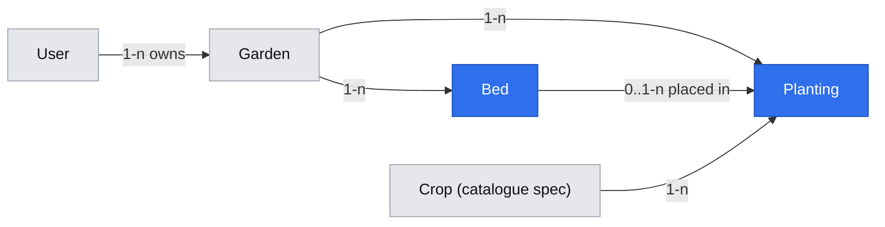

# Garden grid: plant list, square-foot beds, multi-cell plantings and companion warnings

- **Status:** draft (design only).
  - **Phase 1** needs spec A, a minimal crops catalogue with a read API (catalogue spec, not yet written), and the brief's implementation gate D05 (the interviews), unless the owner lifts it.
  - **Phases 2–4** are also blocked on A04 (#13: the owner's paper layout).
- **Date:** 2026-10-20
- **Origin:** issue #13 (E01-T03, A04), Epic #11. Product item: D07 Now #2 (beds with companion warnings).
- **Depends on:**
  - [`2026-10-20-app-primitives.md`](2026-10-20-app-primitives.md) (spec A), all phases.
  - A crops catalogue spec, not yet written (standards §5 step 4, D04), for the `CropFootprint` and companion-relation contracts below.
- **Design authority:** `.ai/specs/product-brief.md` (R07 supersedes R01; R04, N01, D02, D07, D10), `AGENTS.md` Domain invariants

## 📝 TLDR

The owner grows vegetables, berry bushes and fruit trees (D02) and wants to place them on square-foot beds. The beds should warn about bad neighbours (R04), and the plants have to stay on record even when one, such as a tree in the lawn, isn't in any bed (D10). Today there are no beds or plantings. **Proposed (future behavior):**

1. A **plant list per garden**: plantings that don't need a bed, which the calendar (D07 #1) can use before any layout exists.
2. **Beds** as `rows × cols` grids.
3. **Placement** of a planting as a whole-cell rectangle, checked by pure grid rules inside one locked, versioned transaction.
4. **Companion conflicts** computed server-side and returned with the bed.

## Resolved gate (owner, 2026-10-20)

- Two specs; this one consumes spec A.
- Full design now, grid phases (2–4) blocked on A04.
- **A planting may exist without a bed** (D10 → brief R07, superseding R01): it has no cells, isn't grid-checked and has no neighbours.

## 📝 Problem Statement

- The owner's account says companion planting is a problem `[INTERVIEW]`. The brief's flow has the user "lay the plants out in a bed and see companion warnings". That requires beds, cell placement and server-side conflict detection (R04, N01).
- D02 puts bushes and trees on the same grid as multi-cell plantings. Whether that represents them well is A04, which is untested: #13's layout hasn't been supplied. The walkthrough flagged "a tree outside any bed has no place on the grid" (H02, `[SYNTHETIC]`). D10 answers that case by design. The other A04 cases (canopy, shade, growth over years) stay open. This spec doesn't model them and lists them as risks.
- The calendar (D07 #1, built first) needs to know *what the user grows*, independently of layout. A plant list without beds serves it directly.

## 📝 Proposed Solution

One aggregate per bed. Pure rules decide validity, and the service locks the bed, checks and persists.

- `Planting` belongs to a **garden** (its ownership root) and **optionally** to a bed. When it's in a bed it has a rectangle (`row`, `col`, `rowSpan`, `colSpan`). When it isn't, all four are null (a DB check enforces both-or-neither).
- **Occupancy model:** a rectangle per planting, with overlap checked in the service while the bed row is locked (`withAggregateLock` from spec A). The alternatives lost:
  - A **cell-occupancy table** with `unique(bed, row, col)` lost on write amplification. A 6×6 tree is 36 rows, rewritten on every move or resize. It would also need a second source of truth.
  - A **Postgres exclusion constraint** (`btree_gist`, `int4range && int4range`) lost on cost: it needs a DB extension the shared sandbox database may not allow, and MikroORM's snapshot doesn't model it. It remains a defence-in-depth upgrade with no API change.
- **Footprint:** each crop declares either `plantsPerCell` (1, 4, 9 or 16: small crops; a rectangle of k cells holds `k × plantsPerCell` plants) or `cellsPerSide` (n ≥ 2: one plant needs at least an n×n block, which is how bushes and trees work). The planting stores the derived `plantsPerCell`, or `null` for a multi-cell plant, which is one plant per rectangle (`AGENTS.md` "stores `plantsPerCell` derived from crop spacing").
- **Neighbours** for companion checks: two placed plantings in the same bed whose rectangles are within one cell of each other, diagonals included (Chebyshev distance ≤ 1). An unplaced planting has no neighbours.
- **Concurrency:** every write that changes a bed's occupancy sends the bed `version` it last saw. A mismatch returns 409 `STALE_VERSION`, and the client reloads (`AGENTS.md`: never last-write-wins).
- **Planting row lock:** a write to an existing planting also locks the planting row. This covers concurrent writes that touch no common bed:
  - two "place" requests sending the same unplaced planting into different beds
  - a delete racing a place

  Lock order, always: the touched beds in ascending id, then the planting (`SELECT … FOR UPDATE`). After locking, the service re-reads `planting.bed_id`. If it's no longer the bed the request computed its touched set from, the request gets 409 `STALE_VERSION` and nothing is written.
- **Same-garden guarantee:** a composite FK `(bed_id, garden_id) → beds(id, garden_id)` (with `unique(id, garden_id)` on `beds`) makes a planting in another garden's bed impossible at the DB level, even when the user owns both gardens. The check fails closed. If MikroORM can't model it, it goes in reviewed migration SQL.
- **Count limits** (`MAX_BEDS_PER_GARDEN`, `MAX_PLANTINGS_PER_GARDEN`) are checked while the parent garden row is locked `FOR UPDATE OF gardens`, so concurrent creates can't exceed the limit.

## 📝 Architecture

| Layer | New | Built on (spec A) |
|---|---|---|
| `db/src/entities/gardens/bed.entity.ts`, `db/src/entities/plantings/planting.entity.ts` | entities + migrations, `ownedBy.bed`, `ownedBy.planting` | base entity, owner filters |
| `core/src/services/plantings/grid-rules.ts` (pure) | `validatePlacement`, `validateBedResize`, `derivePlantsPerCell`, `neighbourPairs` | `RuleResult` |
| `core/src/services/crops/companions.ts` (pure) | `findConflicts(placed, relations) → Conflict[]` | `RuleResult`-style data, no I/O |
| `db/src/aggregate-lock.ts` + `core/src/services/shared/aggregate-write.ts` | **first build** of `withAggregateLock` | designed in spec A |
| `core/src/services/gardens/bed.service.ts` | CRUD + `getView(actor, bedId)` → `BedView` | `CrudService`, `findOwnedOrFail` |
| `core/src/services/plantings/planting.service.ts` | `listForGarden`, `create` (unplaced), `placeNew`, `move`, `unplace`, `remove` | `withAggregateLock`, `throwIfViolations` |
| `core/src/http/errors.ts` | `CellOccupiedError` (Conflict, `CELL_OCCUPIED`), `OutOfBedBoundsError` (Validation, `OUT_OF_BOUNDS`), `FootprintTooSmallError` (Validation, `FOOTPRINT_TOO_SMALL`), `BedTooSmallForPlantingsError` (Conflict, `PLANTINGS_OUT_OF_BOUNDS`) | `AppError` |
| `core/src/validators/{gardens,plantings}/` | `bed-create`, `bed-update`, `planting-create`, `planting-place`, `planting-move` schemas | common validators, limits |
| `app/src/app/api/...` | routes below | `makeCrudRoute`, `apiHandler` |
| `ui/src/backend/grid/CellGrid.tsx` | **first build** of the generic grid | designed in spec A |
| `ui/src/components/gardens/BedGrid.tsx`, `ui/src/components/crops/{CropPicker,CompanionBadge}.tsx` | concept components | `CellGrid`, `DataTable`, feedback |

**Crops dependency (contract only; the catalogue spec owns the data):** `CropService.getFootprints(ids) → Map<cropId, { kind: "vegetable" | "herb" | "bush" | "tree", plantsPerCell: 1|4|9|16 } | { kind, cellsPerSide: number }>` and `CropService.relationsAmong(ids) → { cropId, otherCropId, relation: "companion" | "combative", source }[]`. Phase 1 only needs the crop to exist, Phase 3 needs footprints, and Phase 4 needs relations. Every fact carries a `source` (R03).

**`AGENTS.md` invariant updates:** "a `Planting` occupies a cell rectangle" becomes "a placed `Planting` …; an unplaced planting has none (R07)". This lands in spec A step 1.

## 📝 Data Model

| Entity | Table | Fields (beyond base) | Constraints |
|---|---|---|---|
| `Bed` | `beds` | `garden` → `gardens` (cascade), `name` `varchar(60)`, `rows` `smallint`, `cols` `smallint`, `version` `int` default 1 | `1 ≤ rows,cols ≤ MAX_BED_DIMENSION` (check), `MAX_BEDS_PER_GARDEN` in the service |
| `Planting` | `plantings` | Phase 1: `garden` → `gardens` (cascade), `crop` → `crops`, `note` `varchar(200)` null. **Phase 3 adds** (one migration, after A04): `bed` with composite FK `(bed_id, garden_id)` → `beds(id, garden_id)` **`NO ACTION`** (checked at the end of the statement, so a garden-delete cascade succeeds; the service unplaces before deleting a bed), `row`, `col`, `rowSpan`, `colSpan` `smallint` null, `plantsPerCell` `smallint` null (null when unplaced or multi-cell) | check (Phase 3): `bed_id` null ⇔ all four geometry columns null; spans ≥ 1; `MAX_PLANTINGS_PER_GARDEN` under the garden row lock |

Named constants in `validators/limits.ts`:

- `MAX_BED_DIMENSION = 40` (12 m in 1 ft cells, enough for a long allotment strip; revisit with A04 case 7).
- `MAX_BEDS_PER_GARDEN = 50`.
- `MAX_PLANTINGS_PER_GARDEN = 500`.
- `MAX_PLANTING_NOTE = 200`.

These constants are proposals. A04 may change them.

The check constraint is declared through MikroORM's entity `checks` option if `defineEntity` supports it in v7, otherwise as reviewed migration SQL. Verify this at Phase 2, step 1.

`User` and `Garden` come from spec A. `Crop` comes from the future catalogue spec. Ownership always runs `Planting → Garden → User`, never through `Bed`, so an unplaced planting is still owned.

## 📝 API Contracts

`BedView = { bed: { id, gardenId, name, rows, cols, version }, plantings: PlacedPlantingDto[], conflicts: Conflict[] }`. `Conflict = { aId, bId, cropId, otherCropId, relation: "combative", source }`. Only combative pairs are conflicts. Companion pairs are returned as `companions` only if the UI shows them (Phase 4 decides; default: no).

| Route | Kind | Request | Success | Errors |
|---|---|---|---|---|
| `GET, POST /api/gardens/[id]/plantings` | `apiHandler` | POST: `{ cropId, note? }` | list `PlantingDto[]` (placed + unplaced) / 201 `PlantingDto` (unplaced) | `NOT_FOUND`, `LIMIT_REACHED`, `UNKNOWN_CROP` |
| `GET, POST /api/gardens/[id]/beds` | `makeCrudRoute` collection, `parent: "id"` | POST: `{ name, rows, cols }` | `BedDto[]` / 201 `BedDto` | `LIMIT_REACHED`, `VALIDATION_FAILED` |
| `GET /api/beds/[id]` | `apiHandler` | — | `BedView` | `NOT_FOUND` |
| `PATCH /api/beds/[id]` | `apiHandler` | `{ version, name?, rows?, cols? }` | `BedView` | `STALE_VERSION`, `PLANTINGS_OUT_OF_BOUNDS` (`details.plantingIds`) |
| `DELETE /api/beds/[id]?version=n` | `apiHandler` | — | `{ id, unplacedPlantingIds }`: its plantings become unplaced, not deleted | `STALE_VERSION` |
| `POST /api/beds/[id]/plantings` | `apiHandler` | `{ version, cropId, row, col, rowSpan, colSpan, note? }` (create and place in one step) | 201 `BedView` | `OUT_OF_BOUNDS`, `CELL_OCCUPIED` (`details.cells`, `details.plantingIds`), `FOOTPRINT_TOO_SMALL` (`details.minCellsPerSide`), `STALE_VERSION` |
| `PATCH /api/plantings/[id]` | `apiHandler` | `{ placement: { bedId, row, col, rowSpan, colSpan } \| null, bedVersions: Record<bedId, number> }`: place, move within or across beds, resize, or unplace | `{ plantings, beds: BedView[] }` for every touched bed | as above; `bedVersions` must contain every touched bed, else `VALIDATION_FAILED` |
| `DELETE /api/plantings/[id]?bedVersion=n` | `apiHandler` | `bedVersion` required only when the planting is placed | `{ id }` | `STALE_VERSION` |

Every bed write runs as one `withAggregateLock` call: lock → version → `grid-rules` → persist → bump. A cross-bed move locks both beds in id order. A write to an existing planting then locks the planting row and re-checks its `bed_id` (see Proposed Solution). `DELETE /api/plantings/[id]` of an unplaced planting still locks the planting row, so it can't race a concurrent place. Every write route takes `bedId`/`plantingId` only from the path or the body, resolves its garden through `ownedBy.*`, and never accepts a client `gardenId` for a bed or planting.

## 📝 Grid rules (pure, tests first)

| Function | Rule | Violation codes |
|---|---|---|
| `validatePlacement({ bed, others, rect, footprint })` | rect inside `[0, rows) × [0, cols)`; no overlap with `others` (the moving planting is excluded); `cellsPerSide` crops need `rowSpan ≥ n && colSpan ≥ n` | `OUT_OF_BOUNDS`, `CELL_OCCUPIED` (meta: overlapping cells + ids), `FOOTPRINT_TOO_SMALL` |
| `validateBedResize({ rows, cols, placed })` | every placed rect still inside | `PLANTINGS_OUT_OF_BOUNDS` |
| `derivePlantsPerCell(footprint)` | `plantsPerCell` for small crops, `null` for multi-cell | — |
| `neighbourPairs(placed)` | pairs at Chebyshev distance ≤ 1 | — |
| `findConflicts(placed, relations)` (crops/companions.ts) | combative relation between a neighbour pair, symmetric lookup | — |

Table-driven edge cases (`AGENTS.md` Tests):

- placements at each bed border and corner, and one cell past each
- 1×1 bed
- an empty bed
- a tree whose footprint equals the bed
- a tree one cell short
- a move onto its own old cells (must pass)
- touching vs overlapping rectangles
- diagonal neighbours
- the same crop twice
- a relation listed in only one direction
- a bed shrunk exactly to its plantings' extent vs one cell further

## 📝 UI/UX

- **`(app)/gardens/[gardenId]` (garden overview):**
  - Beds appear as cards (name, `rows × cols`, conflict count) with "New bed" (`CrudForm`: name, rows, cols).
  - Below them is the **plant list** `DataTable` (crop, where: "Bed A, row 2–3, col 1–2" or "Not in a bed", note) with "Add plant" (`CropPicker` + note) and row actions: place in bed, remove.
- **`(app)/gardens/[gardenId]/beds/[bedId]` (bed editor):** `BedGrid` renders `CellGrid`. Plantings are labelled blocks, conflicting ones get a `CompanionBadge` outline, and a conflict list sits under the grid, with the source on every row.
  - **Place:** tap an empty start cell, tap the end cell, then pick a crop in a sheet (`CropPicker`, which shows each crop's minimum footprint) and confirm. The sheet also offers "From plant list" to place an unplaced planting.
  - **Edit:** tap a planting to get Move, Resize, "Take out of bed" (unplace) and Remove (with `ConfirmDialog`).
  - **Errors:** a server violation highlights `details.cells` and shows the message. On `STALE_VERSION` the page shows "This bed changed on another device, reloaded" and calls `router.refresh()`.
  - **States:** an empty bed shows "Tap two cells to place a plant". A bed write is pending until the server's `BedView` arrives, and there's no optimistic grid update, because validity is server-only.
- **Mobile first:** cells are at least 44 px. A bed wider than the viewport scrolls horizontally inside its own container. A tap sequence replaces drag; drag on desktop is a later enhancement.
- **Accessibility:** `role="grid"`, arrow keys move the focus, Enter starts or ends a selection, Escape cancels, and every cell has an `aria-label` (e.g. "Row 3, column 2, blueberry").

## 📝 Edge Cases & Failure Scenarios

| Scenario | Behavior |
|---|---|
| Two devices place into the same cells | The second request waits for the row lock, sees a bumped version, and gets 409. Its client reloads. |
| Double tap on "Place" | The second request carries the old version → 409, so no duplicate is created. The client ignores it because the first response already updated the view. |
| Move across beds while each is edited elsewhere | Both versions are checked under the two locks (taken in id order). Any mismatch returns 409 and nothing is written. |
| Bed shrunk below its plantings | 409 `PLANTINGS_OUT_OF_BOUNDS` lists the plantings. The user moves or unplaces them first. |
| Bed deleted | Its plantings become unplaced, the list keeps them, and the calendar still sees them. |
| Garden deleted | Beds and plantings cascade. The `NO ACTION` planting→bed FK is checked at the end of the statement, so cascade order doesn't matter (integration test: delete a garden that has placed plantings). |
| Same planting placed into two beds at once | Each request locks its target bed, then the planting row. The second request sees a changed `bed_id` → 409. |
| Crop removed from the catalogue (seed change) | Catalogue spec concern: FK `restrict`, so a seed must not delete a crop in use. |
| Crop footprint changes in a seed release | Existing placements aren't re-validated retroactively. The next move or resize applies the new rule. This is documented, not hidden. |
| Tree canopy, shade, growth over years (A04 cases 2–5) | **Not modelled.** The grid shows the footprint the user chose. The owner's #13 layout decides whether that is acceptable. |

## 📝 Risks & Impact Review

- **A04 is untested.** If the owner's layout shows a canopy or shade misrepresentation that matters, Phases 3–4 change (for example a canopy rect separate from the trunk footprint). Phase 1 and D10 hold either way. This is the gating risk, and the spec is explicitly blocked on it.
- **D07 order:** the calendar is Now #1. This spec's Phase 1 (the plant list) is what the calendar needs, so it can ship before the calendar. Phases 2–4 come after the calendar unless the owner reorders.
- **Catalogue dependency:** footprints and relations are owner-written (D04, A03). Without them Phase 3 can only place `plantsPerCell` defaults, and Phase 4 has no conflicts to show.
- **Contracts:** new routes, tables and error codes are recorded in `BACKWARD_COMPATIBILITY.md` as they land. The migrations are additive.
- **Rollback:** each phase's migration has a down migration. Dropping `plantings` loses the user's plant list, so the down migration is for development only once real data exists.

## 📝 Decisions in play

- **R07 / D10** (owner, 2026-10-20): a planting may have no bed. It supersedes R01 and is reviewed when A04's result arrives.
- **N01** (no freehand): unplaced isn't free-position. It has no position at all, so N01 stands.
- **R04** (server-side conflicts), **R03** (sourced facts), **D02** (bushes and trees), **D07** (order), **N02** (no AI write path; this spec has no AI).

## 📋 Phasing

| Phase | Ships | Gate |
|---|---|---|
| 1 | Plant list: the `Planting` entity with no bed or geometry columns, list and create/remove API, plant list on the garden page | spec A done; catalogue spec Phase 1 (a `Crop` entity and a crops list API for `CropPicker`); D05 |
| 2 | Beds: the `Bed` entity, CRUD with version, `withAggregateLock` (first build), `useMutation` `onConflict` and the conflict notice (first build), empty-bed view | **A04** |
| 3 | Placement: the `bed_id`/geometry migration with the check and composite FK, `RuleResult` (first build) + grid rules, place, move, resize, unplace, `CellGrid` + `BedGrid`, 409 handling | **A04**; crop footprints in the catalogue |
| 4 | Companion conflicts in `BedView`, conflict list and badges | catalogue relations (D04) |

## 📋 Implementation Plan

### Phase 1 — Plant list
1. `planting.entity.ts` (`garden`, `crop`, `note` only) + migration `add-plantings`, `ownedBy.planting`. Tests: entity metadata.
2. `PlantingService.listForGarden/create/remove`, `planting-create.schema.ts`, `api/gardens/[id]/plantings/route.ts`, `api/plantings/[id]/route.ts` (DELETE). The limit is checked under the garden row lock. Tests: owned and foreign garden, limit, unknown crop.
3. The garden overview page with the plant list (`DataTable`, add with `CropPicker`). Integration: add a blueberry with no bed, reload, and see it listed.

### Phase 2 — Beds (blocked on A04)
4. `bed.entity.ts` (`version`, `unique(id, garden_id)`) + migration `add-beds`; `ownedBy.bed`. Verify `defineEntity` support for `checks` and composite FKs.
5. `withAggregateLock` (`db/src/aggregate-lock.ts` + its `core` error mapping, as designed in spec A). Tests: unit (version mismatch, foreign bed → not found, id-ordered multi-lock, the lock query locks only `beds`); integration: two concurrent writes → one 409.
6. `BedService` (CRUD, `getView`, delete-unplaces), bed schemas, `makeCrudRoute` for `gardens/[id]/beds`, `apiHandler` for `beds/[id]`; `useMutation` `onConflict` + the `sonner` notice. Tests: route tests, a stale `PATCH` → 409, the bed limit under concurrency.
7. Bed cards on the garden page plus an empty bed editor page.

### Phase 3 — Placement (blocked on A04, needs footprints)
8. `rules/rule-result.ts` (designed in spec A) and `grid-rules.ts`, tests first (table above).
9. Migration `add-planting-placement`: `bed_id`, geometry, `plants_per_cell`, the both-or-neither check, the composite `NO ACTION` FK. Tests: a DB-level integration test (direct SQL against the ephemeral Postgres from `tests/integration/support/database.ts`) shows that a half-placed row and a cross-garden bed are rejected and that deleting a garden with placed plantings succeeds.
10. `PlantingService.placeNew/move/unplace` via `withAggregateLock` + the planting row lock + grid errors; `POST /api/beds/[id]/plantings`, `PATCH /api/plantings/[id]`. Tests: every violation → its code and `details`; cross-bed move; unplace; a changed `bed_id` after locking → 409.
11. `ui/src/backend/grid/CellGrid.tsx` (selection, keyboard, highlights). Tests: tap-tap rectangle, keyboard selection, `aria-label`s.
12. `BedGrid` + `CropPicker` + editor wiring with `useMutation` (`onConflict` → refresh). Integration: place a 3×3 tree and a 1×1 lettuce; an overlapping placement shows `CELL_OCCUPIED`; a stale tab gets 409 and reloads (the `AGENTS.md`-required test).

### Phase 4 — Companion conflicts (needs relations)
13. `crops/companions.ts` `findConflicts`, tests first (symmetry, diagonal, unplaced excluded).
14. Conflicts in `BedView`; `CompanionBadge` + the conflict list with sources. Integration: two combative crops side by side show one conflict, and moving one away clears it.
15. Update `BACKWARD_COMPATIBILITY.md` (routes, tables, codes) and `AGENTS.md` where an invariant changed.

## 📝 Research notes

From general knowledge of these products, not re-checked online today, except Planter:

- **Planter** (benchmark, checked 2026-10-17): a beginner can finish its square-foot grid, and it shows companion hints beside the plan. We match the grid and the hints, keep relations sourced and server-side, and copy nothing.
- **react-grid-layout:** items `{ x, y, w, h }` with collision detection, the same rectangle model. We skip its compaction and auto-flow, because placement here is explicit and the server decides.
- **Square-foot gardening convention:** 1, 4, 9 or 16 plants per square, with large plants taking several squares. That's the source of the `plantsPerCell` / `cellsPerSide` split.
