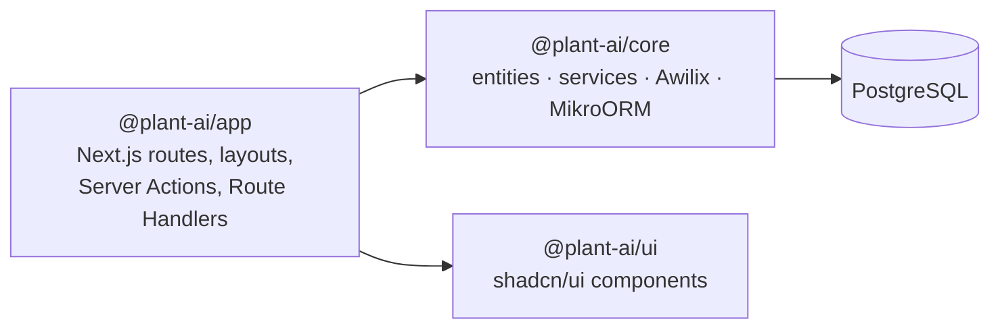

# 🌱 Plant.AI

Plant.AI is a garden-planning web app, in the spirit of [planter.garden](https://planter.garden/app/gardens). You lay out gardens and beds, place plants with companion-planting hints, and get AI-assisted growing advice.

> Coding agents: the binding rules are in [`AGENTS.md`](AGENTS.md). Specs, run logs and lessons live in [`.ai/`](.ai).

## Quick start

Requirements: Node.js ≥ 22.18, npm, Docker (for PostgreSQL).

```bash
npm install
cp .env.example .env            # repo-root .env is shared by Next.js and the MikroORM CLI
docker compose up -d db         # PostgreSQL 17 on localhost:5432
npm run db:migrate              # apply migrations
npm run dev                     # http://localhost:3000
```

- Public site: <http://localhost:3000>
- Admin: <http://localhost:3000/admin> (example CRUD: *Gardens*)
- Health probe: <http://localhost:3000/api/health>

## Architecture

### Stack

| Layer | Technology |
| --- | --- |
| Web framework | Next.js 16 (App Router, Turbopack), React 19, TypeScript (strict) |
| Database | PostgreSQL |
| ORM / migrations / pooling | MikroORM 7 (`@mikro-orm/postgresql`, `@mikro-orm/migrations`) |
| Dependency injection | Awilix |
| Public frontend styling | Tailwind CSS v4 |
| Backend (admin) UI | shadcn/ui on Tailwind v4 |
| Monorepo | npm workspaces |

### Packages

```
.
├── packages/
│   ├── app/    @plant-ai/app   Next.js application — integration layer / composition root
│   ├── core/   @plant-ai/core  Domain & persistence — entities, migrations, services, DI container
│   └── ui/     @plant-ai/ui    shadcn/ui component library + admin theme
├── docker-compose.yml          Local PostgreSQL
├── tsconfig.base.json          Shared compiler options
└── .env.example                Environment variables (copy to .env)
```



- **`@plant-ai/app`**: the only package that knows about Next.js. It holds routing, layouts, Server Actions and Route Handlers, and stays thin: validate input, resolve a service, render.
- **`@plant-ai/core`**: server-only business logic and persistence. It has no Next.js or React dependencies.
- **`@plant-ai/ui`**: presentational shadcn/ui components used by the admin pages.

Internal packages are consumed as TypeScript source (no build step). Next.js transpiles them.

### Frontend vs. backend pages

`packages/app/src/app` uses two route groups, each with its **own root layout and stylesheet**:

| Route group | URL | Styling |
| --- | --- | --- |
| `(frontend)/` | `/`, … | Tailwind CSS with Plant.AI `@theme` tokens (`frontend.css`) |
| `(admin)/admin/` | `/admin/…` | Tailwind + shadcn/ui theme from `@plant-ai/ui/styles.css` (`admin.css`) |

Because these are separate root layouts, moving between the public site and the admin is a full page load. That keeps the two design systems fully isolated.

### Request lifecycle & dependency injection

```
Request ─► Server Component / Server Action / Route Handler
             └─ withRequestScope(({ gardenService }) => …)        packages/app/src/server/request-scope.ts
                  └─ Awilix scope: em = orm.em.fork()              packages/core/src/di/container.ts
                       └─ GardenService({ em }) → MikroORM → PostgreSQL
```

- The **root container** holds singletons (`orm`). Each request creates a **scope** that registers a forked `EntityManager` (its own identity map / unit of work), and services are registered as `scoped`.
- The global `EntityManager` is disabled (`allowGlobalContext: false`), so any code that bypasses the scope fails loudly.
- The ORM and the container are cached at **module level**, not on `globalThis`. Next.js evaluates Server Components, Route Handlers and Server Actions in separate module layers, and MikroORM identifies entities by class reference. In practice each layer gets its own pool, so set `DB_POOL_MAX` with that in mind.

### Persistence

- Entities are defined with `defineEntity` (no decorators) in `packages/core/src/entities` and registered in `entities/index.ts`.
- Connection pooling is configured by `DB_POOL_MIN` / `DB_POOL_MAX`.
- Migrations live in `packages/core/src/migrations` and are generated from entity changes:

  ```bash
  npm run db:migrate:create -- --name add-beds   # diff entities → new migration
  npm run db:migrate                             # apply
  npm run db:migrate:down                        # roll back the last one
  ```

### Environment variables

| Variable | Default | Purpose |
| --- | --- | --- |
| `DATABASE_URL` | — (required at runtime) | PostgreSQL connection string |
| `DB_POOL_MIN` / `DB_POOL_MAX` | `0` / `10` | Connection pool size |
| `DB_DEBUG` | `false` | Log SQL queries |

`.env.local` and `.env` are read from the **repo root**, both by `next.config.ts` and by the MikroORM CLI config. Variables already set in the environment take precedence.

## Scripts

| Command | Description |
| --- | --- |
| `npm run dev` | Start the Next.js dev server |
| `npm run build` / `npm start` | Production build / start |
| `npm run typecheck` | Type-check all packages |
| `npm run lint` | Lint |
| `npm run db:migrate` · `db:migrate:create` · `db:migrate:down` | Database migrations |
| `npm run ui:add -- <component>` | Add a shadcn/ui component to `@plant-ai/ui` |

## AI-assisted development

This repo uses Spec-Driven Development with the `.ai/` folder (`specs/`, `runs/`, `lessons.md`). See [`AGENTS.md`](AGENTS.md).
